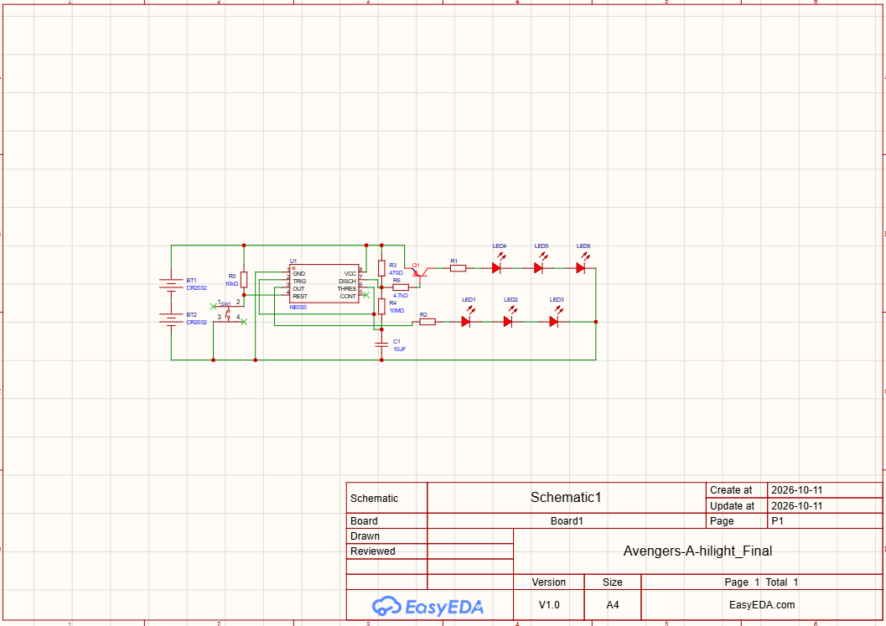
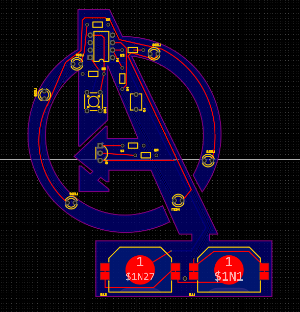
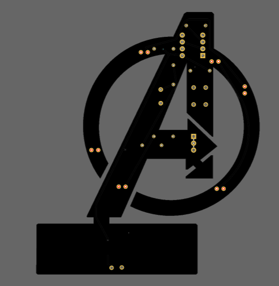
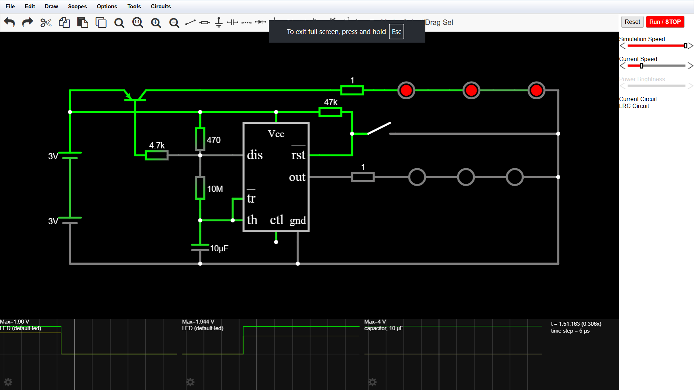

# Avengers Logo LED PCB

## About the Project

This project is an Avengers logo PCB with LED backlighting, made for the Hack Club Solder program. It uses a 555 timer IC configured as an astable oscillator with an approximately 110-second period to switch between two groups of LEDs. One group is driven by the timer output, while the other is controlled through a PNP BJT connected to the discharge pin. The PCB is designed with three terminals for each group, allowing the number of LEDs to be decided after receiving the randomly coloured LEDs from Hack Club. Unused positions will be shorted as needed. The initial power source is two CR2032 batteries, with the option to use another supply if required.

The PCB is designed to be placed slightly away from a wall, allowing the LEDs on the back to spread light across the surface behind the Avengers logo . The exposed pinouts and connections on the front are therefore intentional, as the board is meant to be used in dark with the backlighting creating the visual effect.

## My Experience

I chose the Avengers logo because I enjoy Marvel movies and characters, and the letter 'A' is also the first letter of my name. Since this is my first PCB, I wanted to make something I personally liked rather than just a basic circuit.

I had previously experimented with EasyEDA using a simple LED and resistor circuit, but I hadn't completed it properly. For this project, I first simulated the circuit and worked on understanding the 555 timer before designing the schematic.

I initially thought PCB design would mainly involve arranging components from the schematic. However, positioning components without obstructing traces and routing connections neatly took more time than I expected. I also learned to identify and correct Design Rule Check (DRC) errors. Routing ground connections to LEDs placed along the narrow edges of the logo was challenging, so I used a bottom-layer copper pour connected to ground.

After completing the layout, I discovered that the PCB orientation was upside down and corrected it by flipping the design. This project gave me practical experience with schematic design, PCB routing, copper pours and DRC checks. It also strengthened my interest in electronics and motivated me to explore more circuits and PCB projects.
## Bill of Materials (BOM)

| Component | Quantity |
|---|---:|
| LEDs | 6 |
| 555 timer IC | 1 |
| Resistors | 6 |
| Capacitors | 1 |
| CR2032 battery holder | 2 |
| pnp transistor | 1 |

## Design Files

### 1. Schematic

### 2. PCB Layout

### 3. 3D View

## Manufacturing Files

The Gerber and drill files exported from EasyEDA are included in the `gerber/` folder.

## Software Used

- EasyEDA — Schematic and PCB design

## Circuit Simulation

The circuit was tested in Falstad to check the intended switching behaviour of the 555 timer and the two LED groups.

- **Simulation:** [View the Falstad circuit](https://www.falstad.com/s.php?s=Swhze6)
- **Screenshot:** 

## Hack Club Solder

**Slack Username:** abineshsj2008
